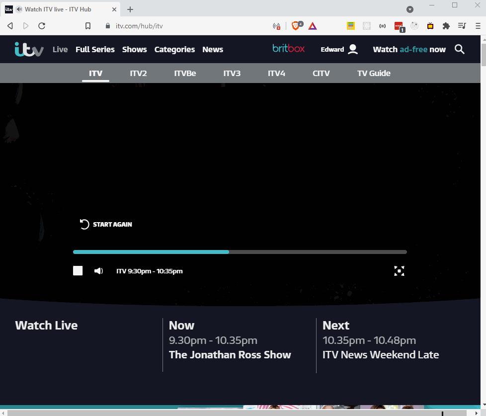

# simple-cinema

This browser extension lets the user choose videos on the page to destructively replace page content.

### why

- This is good for sites that don't let you pick the size of the video player.
- Removes obtrusive ads
- Focus on just the video content
- pick a background colour for the page (makes a theatre mode)
- pick playback speed

### preview



### Run locally

1. Install dependencies and build the extension:
   ```bash
   pnpm install
   pnpm build
   ```
   (Use `pnpm dev` to rebuild automatically on file changes.)
2. Open `chrome://extensions/` (or any Chromium-based extensions page)
3. Turn developer mode on
4. Click "Load unpacked" button and load the `dist` directory
5. Pin extension for easy use
